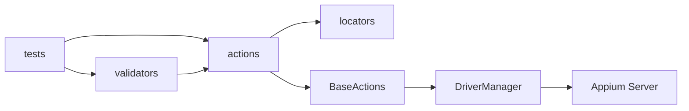

# mobile-appium-java-framework

Reusable **Android UI automation** framework using **Java · Appium · TestNG**, with **locators / actions / validators / tests** separation.

Covers **login**, **form inputs**, and **error states** against [Sauce Labs My Demo App Android](https://github.com/saucelabs/my-demo-app-android). Includes a full **sanity suite** (7 scenarios).

## Architecture

Layered design:

```text
tests/          Thin scenarios — call actions + validators only
validators/     Assertions (Assert.*)
actions/        Clicks, type, navigation (uses locators)
locators/       By locators only — no logic
base/           BaseActions (tap/type/wait) + BaseTest
driver/         AndroidDriver lifecycle
config/         Properties + env overrides
utils/          Waits + screenshots
listeners/      Extent + Allure
```



## Prerequisites

| Tool | Notes |
|------|--------|
| JDK 17+ | Project targets Java 17 |
| Maven 3.9+ | Or use the portable Maven under `Downloads/tools` if installed during setup |
| Node.js + Appium 2 | `npm i -g appium` then `appium driver install uiautomator2` |
| Android SDK + emulator | AVD running, `adb devices` shows device |
| Demo APK | Place under `apps/` (see below) |

## Get the demo APK

1. Open [My Demo App Android releases](https://github.com/saucelabs/my-demo-app-android/releases)
2. Download an APK (example name: `mda-2.2.0-25.apk`)
3. Copy it to `apps/mda-2.2.0-25.apk`  
   Or set `app.path` / env `APP_PATH` to your file

Default package/activity (already in `config.properties`):

- `com.saucelabs.mydemoapp.android`
- `com.saucelabs.mydemoapp.android.view.activities.SplashActivity`

Demo login: `bod@example.com` / `10203040`

## Run locally

```bash
# Terminal 1 — start Appium
appium

# Terminal 2 — start emulator (example)
emulator -avd Pixel_6_API_34

# Terminal 3 — run suite (use mvnw — Maven is not required on PATH)
.\mvnw.cmd clean test
```

Set JDK first in that terminal:

```powershell
$env:JAVA_HOME = "C:\Program Files\Java\jdk-17"
$env:Path = "$env:JAVA_HOME\bin;$env:Path"
```

Smoke / single test:

```powershell
.\mvnw.cmd test "-Dtest=LoginTests#validLoginShowsProducts"
```

Full sanity suite (all cases in one class):

```powershell
.\mvnw.cmd test "-DsuiteXmlFile=src/test/resources/sanity-suite.xml"
```

Reports:

- **Allure (recommended UI):** after tests, run `.\mvnw.cmd allure:serve` — opens the modern Allure dashboard in your browser
- Extent HTML: `reports/extent-report.html` → `Invoke-Item reports\extent-report.html`
- Screenshots on failure: `screenshots/`
- Do **not** open `target/surefire-reports/emailable-report.html` if you want Allure — that is TestNG’s plain report

## Config overrides

| Key | Env override | Example |
|-----|--------------|---------|
| `appium.server.url` | `APPIUM_SERVER_URL` | `http://127.0.0.1:4723` |
| `device.name` | `DEVICE_NAME` | `Pixel_6` |
| `device.udid` | `DEVICE_UDID` | from `adb devices` |
| `app.path` | `APP_PATH` | absolute path to APK |

Optional local file (gitignored): `src/test/resources/config.local.properties`

## CI

GitHub Actions compiles main + test sources on every push/PR (`mvn compile test-compile`).  
Full UI suite stays **local** (needs emulator + Appium).

<!-- ci-check: verify PR Actions -->

