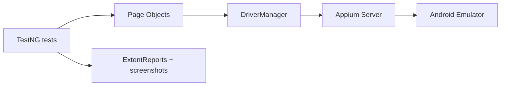

# mobile-appium-java-framework

Reusable **Android UI automation** framework using **Java · Appium · TestNG · Page Object Model**.

Built for interview / portfolio use by **prasandeep** — covers **login**, **form inputs**, and **error states** against [Sauce Labs My Demo App Android](https://github.com/saucelabs/my-demo-app-android).

## Architecture

```text
mobile-appium-java-framework
├── pages/          Page Objects (Catalog, Login, Checkout form, …)
├── driver/         AndroidDriver lifecycle (thread-local)
├── config/         Properties + env overrides
├── utils/          Explicit waits + screenshots
├── tests/          TestNG suites (login / forms / errors)
└── listeners/      ExtentReports + failure screenshots
```



## Prerequisites

| Tool | Notes |
|------|--------|
| JDK 17+ | Project targets Java 17 |
| Maven 3.9+ | Or use the portable Maven under `Downloads/tools` if installed during setup |
| Node.js + Appium 2 | `npm i -g appium` then `appium driver install uiautomator2` |
| Android SDK + emulator | AVD running, `adb devices` shows device |
| Demo APK | Place under `apps/` (see below) |

## Get the demo APK

1. Open [My Demo App Android releases](https://github.com/saucelabs/my-demo-app-android/releases)
2. Download an APK (example name: `mda-2.2.0-25.apk`)
3. Copy it to `apps/mda-2.2.0-25.apk`  
   Or set `app.path` / env `APP_PATH` to your file

Default package/activity (already in `config.properties`):

- `com.saucelabs.mydemoapp.android`
- `com.saucelabs.mydemoapp.android.view.activities.SplashActivity`

Demo login: `bod@example.com` / `10203040`

## Run locally

```bash
# Terminal 1 — start Appium
appium

# Terminal 2 — start emulator (example)
emulator -avd Pixel_6_API_34

# Terminal 3 — run suite
mvn clean test
```

Smoke-only:

```bash
mvn test -Dgroups=smoke
```

Reports:

- HTML: `reports/extent-report.html`
- Screenshots on failure: `screenshots/`

## Config overrides

| Key | Env override | Example |
|-----|--------------|---------|
| `appium.server.url` | `APPIUM_SERVER_URL` | `http://127.0.0.1:4723` |
| `device.name` | `DEVICE_NAME` | `Pixel_6` |
| `device.udid` | `DEVICE_UDID` | from `adb devices` |
| `app.path` | `APP_PATH` | absolute path to APK |

Optional local file (gitignored): `src/test/resources/config.local.properties`

## CI

GitHub Actions compiles main + test sources on every push/PR (`mvn compile test-compile`).  
Full UI suite stays **local** (needs emulator + Appium).

## Interview talking points

- POM keeps locators out of tests; pages model user flows
- Explicit waits over implicit sleeps; screenshots + Extent on failure
- Config layered: properties → system props → env vars
- Suite groups: `smoke`, `login`, `forms`, `negative`

## Author

**prasandeep** — SDET portfolio project (weeks 1–2)
